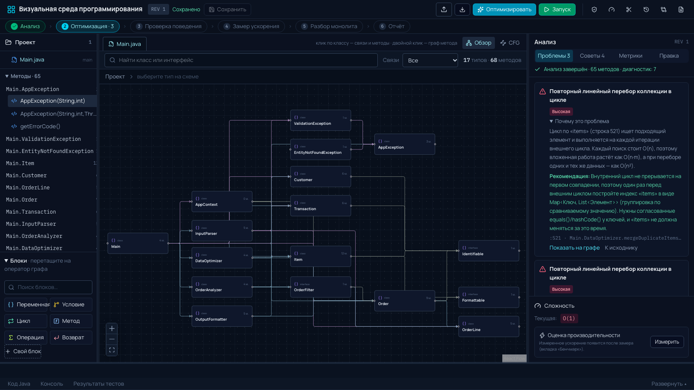
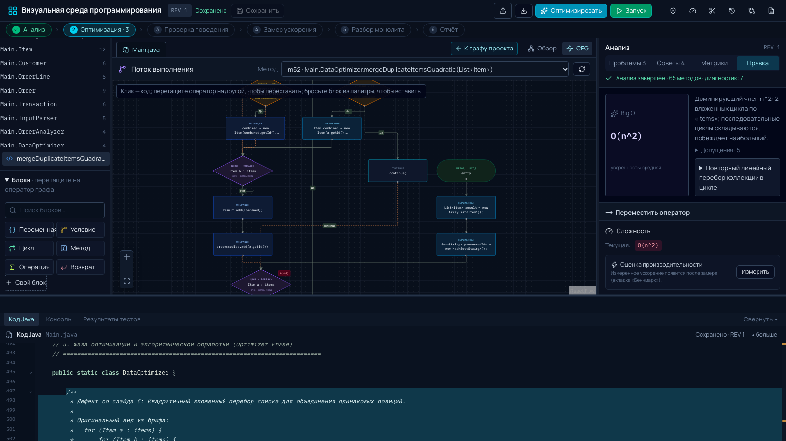
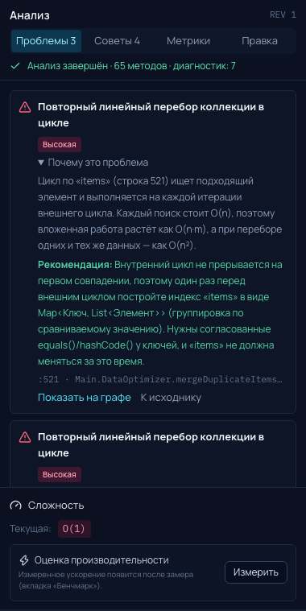
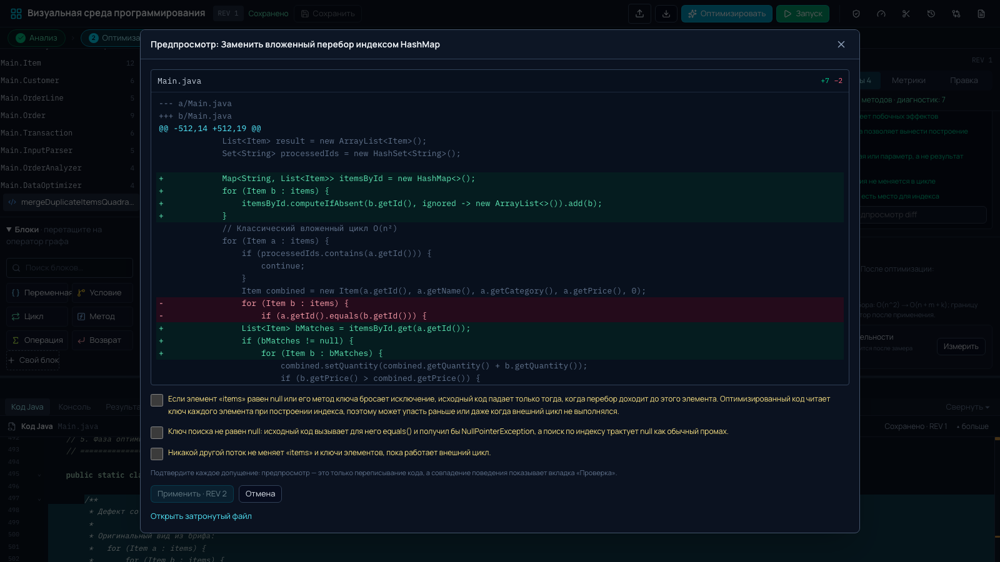
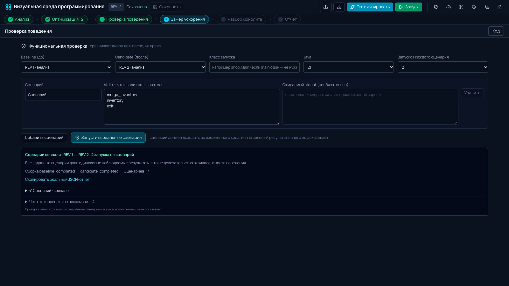

<div align="center">

# Java Blueprints · Unmonolith

**Java-монолит → блок-схема → диагноз Big O → безопасная правка → доказанное сохранение поведения**

Веб-инструмент для кейса Axenix «Визуальная среда программирования»

[](apps/api)
[](apps/parser)
[](apps/web)
[](apps/web)
[](apps/runner)
[](https://github.com/xss-is-team/Unmonolith/actions/workflows/ci.yml)
[](docs/CASE_COMPLIANCE.md)

[Быстрый старт](#быстрый-старт) · [Как это работает](#как-это-работает) · [Возможности](#возможности) · [Архитектура](#архитектура) · [Тесты](#тесты-и-доказательства) · [Ограничения](#честные-ограничения)

</div>

<p align="center">
  
</p>

## Зачем это нужно

В 1000 строках Java-монолита трудно увидеть, **где** код тормозит, и страшно его менять, потому что непонятно, **что сломается**.
Java Blueprints делает три вещи, которые обычно живут в разных инструментах:

1. **Показывает программу как граф**: граф типов проекта и блок-схема (CFG) каждого метода, привязанные к строкам кода.
2. **Находит и объясняет дефекты сложности** (Big O) и предлагает исправление с явными допущениями.
3. **Доказывает, что поведение не изменилось**: запускает версию «до» и «после» на одних и тех же сценариях в изолированном Docker и сравнивает stdout, stderr и код выхода.

Главный принцип: **ничего не выдумывается**. Нет парсера или Docker-образа, значит честная ошибка, а не «зелёная» галочка.

## Как это работает

```
 .java / .zip ─▶ JDT: AST + CFG + граф проекта ─▶ Big O и находки ─▶ правка через ASTRewrite
                                                                           │
   отчёт ◀─ замер времени ◀─ сравнение «до/после» в Docker ◀─ новая ревизия Java ◀┘
```

Шесть шагов пути из кейса идут в интерфейсе по порядку: **Анализ → Оптимизация → Проверка → Замер → Разбор монолита → Отчёт**.

## Возможности

### Видно всё: граф проекта и блок-схемы

Типы и связи монолита на одном экране; двойной клик по классу открывает блок-схему метода. Узлы раскрашены по типу (условие, цикл, вызов, возврат), проблемные помечены, клик по узлу подсвечивает строку кода и наоборот.

<p align="center">
  
</p>

### Диагноз Big O, который можно проверить

Статическая оценка сложности по модели стоимости (по размерам коллекций и размеру ввода), с уровнем уверенности, допущениями и ограничениями. Вызовы через интерфейсы оцениваются по всем реализациям в проекте.

Находки двух видов, по-русски, с «почему это проблема», «что делать» и кнопкой «Показать на графе»:

| Сложность | Качество кода (как в макете кейса) |
|---|---|
| повторный линейный поиск в цикле, вложенный перебор одной коллекции, склейка строки в цикле | длинный метод, глубокая вложенность, много параметров, дублирование логики |

<p align="center">
  
</p>

### Оптимизация с явными допущениями

| Правило | Что делает |
|---|---|
| `nested_scan_to_hashmap` | вложенный поиск по списку → индекс `HashMap` |
| `contains_to_hashset` | `list.contains()` в цикле → `HashSet` |
| `string_concat_to_builder` | `s += x` в цикле → `StringBuilder` |

Перед применением виден **diff** и **допущения, которые нужно подтвердить** (например, «ключ не равен null»). Применение создаёт новую ревизию, откат возможен. Пример со слайда 5 (`merge(a, b)` во вложенном цикле) оптимизируется как есть: анализатор доказывает, что вызываемые методы не меняют коллекцию и ключи.

<p align="center">
  
</p>

### Правка блок-схемы меняет код

Каждая операция проходит предпросмотр и проверку компиляцией:

- **перетащите блок** из палитры (переменная, условие, цикл, вызов, операция, возврат или **свой блок**) на оператор графа: он будет вставлен до или после;
- **перетащите оператор** на другой, чтобы переставить (зависимые операторы переставить не даст);
- заменить условие, заменить или удалить оператор, **извлечь метод**;
- **разбор монолита** на классы: вынос вложенных типов в отдельные файлы и групп методов (`parse*` → `Parsing`) в новые классы.

### Проверка поведения: ключевой контракт кейса

Версии «до» и «после» компилируются и запускаются в одноразовых контейнерах (без сети, read-only файловая система, лимиты CPU и памяти) на одинаковых сценариях stdin.

**Автоматически после каждой правки.** Сценарии предлагаются по коду (команды, которые программа сравнивает с вводом), сохраняются, и после каждой новой ревизии REV 1 сравнивается с ней без единого клика: в шапке горит «Поведение сохранено · 6/6» или «Поведение изменилось». «Запуск» выполняет текущую ревизию в Docker и показывает вывод программы.

<p align="center">
  
</p>

- побайтовое сравнение stdout, stderr и кода выхода, таймаута и переполнения вывода;
- `repeats` (1 до 5): если версия расходится сама с собой, статус `unstable`, а не ложное «поведение изменилось»;
- предупреждение, если сценарии **не доходят** до изменённого кода, и список того, чего проверка не показывает;
- **замер времени** (`POST /benchmark`): прогрев, медианы, тест Манна-Уитни, bootstrap-интервал. Заявление «быстрее в N раз» появляется только при статистической значимости.

### Отчёт и история

Ревизии с diff и откатом, экспорт проекта, отчёт в Markdown (`GET /projects/{id}/report`).

## Быстрый старт

Нужен только Docker:

```sh
docker compose up --build
```

Откройте <http://localhost:3001>, загрузите `.java` или ZIP (готовый монолит на 819 строк для демо: [`apps/api/tests/fixtures/demo/Main.java`](apps/api/tests/fixtures/demo/Main.java)).
API: <http://localhost:3000> (`/swagger-ui`). Контейнер API запускает одноразовые контейнеры раннера через сокет Docker хоста, держите его на отдельной машине (см. [`compose.yaml`](compose.yaml)).

### Без контейнеров (разработка)

Нужны: Rust stable, JDK 21, Maven, Node.js 22+, pnpm 11, Git, pkg-config; Docker только для проверки поведения.

```sh
./dev up              # ставит зависимости, собирает парсер и API, запускает API :3000 и веб :3001
./dev runner-build    # образ раннера для проверки поведения
./dev demo            # сквозной сценарий через реальные API, парсер и Docker; пишет docs/evidence/demo/
```

macOS: `brew install rustup openjdk@21 maven node@22 pnpm@11 pkgconf git docker`. Nix: `nix develop`.
Остальные команды: `./dev` без аргументов.

## Архитектура

Один репозиторий, четыре компонента с жёсткими границами:

| Компонент | Роль |
|---|---|
| [`apps/api`](apps/api) · Rust / Axum | HTTP, гостевые сессии, проекты, ревизии с оптимистичной блокировкой, оркестрация, SSE. **Java не разбирает.** Контракт: [`openapi.yaml`](apps/api/openapi.yaml). |
| [`apps/parser`](apps/parser) · Java 21 + Eclipse JDT | AST, CFG, Big O, граф проекта, перезапись исходника через ASTRewrite. Единственный, кто понимает Java. |
| [`apps/runner`](apps/runner) · Docker JDK 21 | Компилирует и запускает ревизию; контейнер на каждый вызов; загруженный код исполняется **только здесь**. |
| [`apps/web`](apps/web) · Next.js 16 | Интерфейс: React Flow (граф и CFG), CodeMirror, diff, панели проверки. Раскладку графа считает веб, не бэкенд. |

Подробности: [`docs/SOLUTION.md`](docs/SOLUTION.md) · спецификация API: [`apps/api/BACKEND_SPEC.md`](apps/api/BACKEND_SPEC.md) · контракт парсера: [`apps/parser/README.md`](apps/parser/README.md).

## Тесты и доказательства

| Что | Где |
|---|---|
| Парсер, CFG, Big O, оптимизации (228 тестов) | `cd apps/parser && mvn test`, эталонный монолит `Organizer.java` в `AcceptanceTest` |
| API (112 тестов + 20 с реальным Docker), с реальным JAR и JDK | `cd apps/api && cargo test` и `cargo test -- --ignored` |
| Интерфейс против реального API, парсера и Docker (9 сценариев Playwright: оптимизация, автопроверка, запуск, перетаскивание блоков) | `cd apps/web && pnpm exec playwright test` |
| Всё это на каждый push | [GitHub Actions](https://github.com/xss-is-team/Unmonolith/actions/workflows/ci.yml) |
| Сохранённый реальный прогон: оптимизация, проверка 8/8, замер | [`docs/evidence/demo/SUMMARY.md`](docs/evidence/demo/SUMMARY.md) |
| Соответствие требованиям кейса по слайдам | [`docs/CASE_COMPLIANCE.md`](docs/CASE_COMPLIANCE.md) |

## Честные ограничения

- Big O это **статическая оценка**; методы с неизвестными вызовами получают `unknown`, а не выдуманную сложность.
- Зелёная проверка относится **только к заданным сценариям**: это свидетельство, а не доказательство эквивалентности.
- Многопоточность, рефлексия, файлы, сеть и `java.time` вне рамок кейса.
- Разбор монолита механический (по типам и по префиксам методов), а не семантическое распознавание «Parser/Analyzer/Optimizer».
- Нет пошагового «Дебага» по графу.
- Maven и Gradle, внешние зависимости не поддерживаются. Публичного URL и аккаунтов нет: сессии гостевые.

Полный и честный статус по каждому требованию кейса: [`docs/CASE_COMPLIANCE.md`](docs/CASE_COMPLIANCE.md). План: [`ROADMAP.md`](ROADMAP.md).

---

<sub>`legacy/commons-math-3.6.1/` это закреплённый Apache Commons Math 3.6.1, большой корпус для проверки парсера. Не изменять.</sub>
